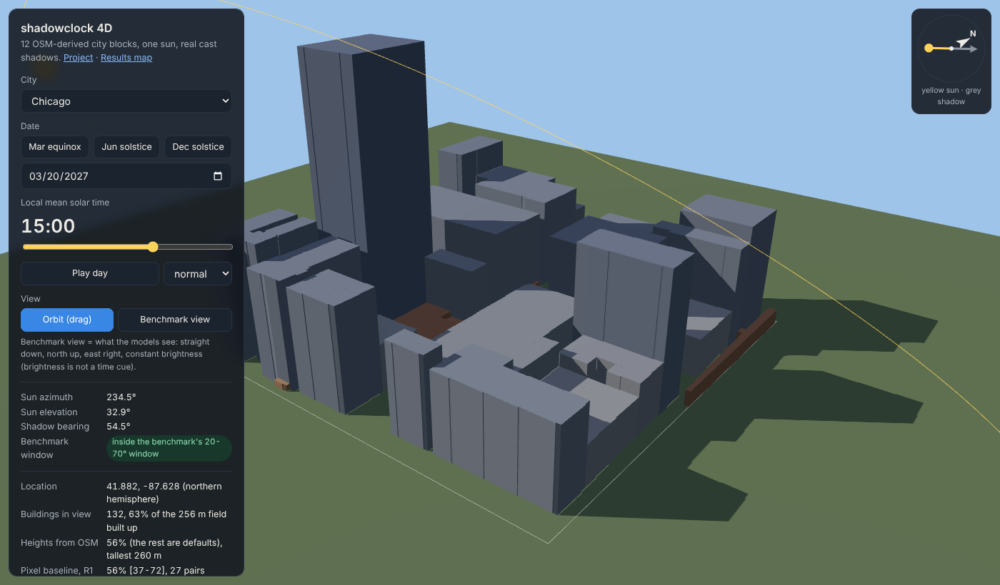
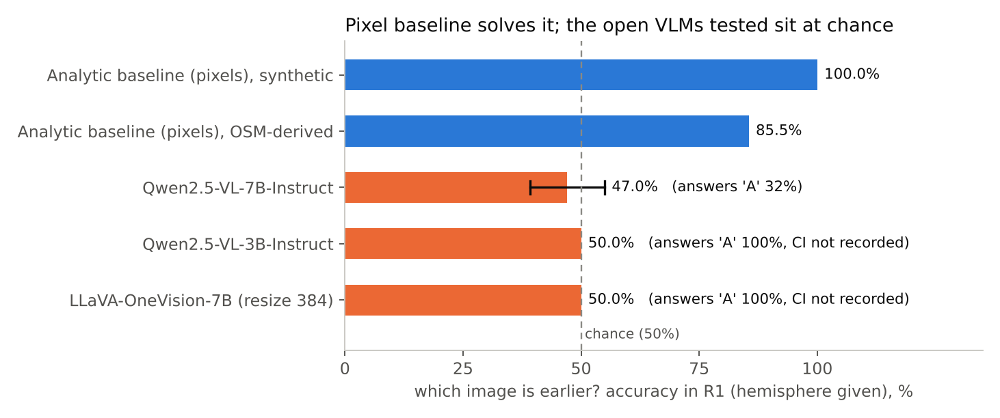
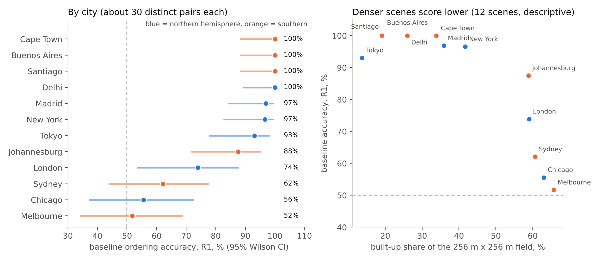
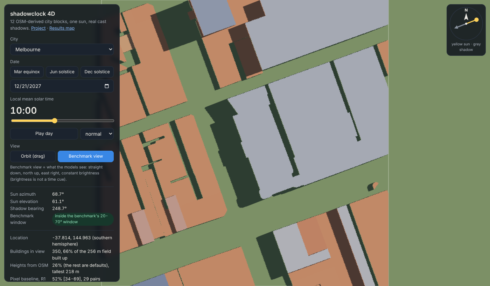
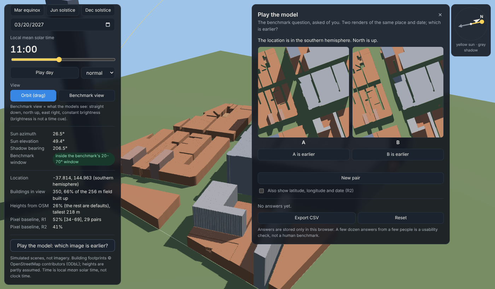

# shadowclock

**Can a vision-language model read the time of day from overhead shadows?** sandbox: https://mshrooom.github.io/shadowclock/

A controlled benchmark with exact ground truth, a pixel-measuring baseline that solves it, twelve OpenStreetMap-derived
city scenes you can watch under a moving sun, and a negative result reported as it is.



> **Status: small, finished-as-a-diagnostic.** Three small open models were tested and they fail in a way that says little
> about shadow reading (see [Honest limits](#honest-limits)). Nothing here claims that frontier models fail.

## Try it (60 seconds)

| What | How |
|---|---|
| **4D sun viewer** | Open `docs/world.html` in a browser. It works from `file://` with no server and no internet. Pick a city, drag the time slider, press *Play day*. |
| **Results map** | Open `docs/map.html`. One circle per city, coloured by the baseline's accuracy. Click a city for numbers, sample renders and a link into the viewer. Basemap tiles need internet. |
| **Landing page** | Open `docs/index.html`. |
| **Run the tests** | `pip install -r requirements-dev.txt && python -m pytest -q` |

To host the three pages: in GitHub, *Settings, Pages, Deploy from a branch, `main`, folder `/docs`*. The `.nojekyll` file is already there.

## The question

Two north-up, straight-down renders of the same place and date, taken at different times. Which one is earlier, and by how many hours?

Information is released in steps, so a failure can be located:

| Regime | The model is given |
|---|---|
| **R0** | the two images |
| **R1** | + the hemisphere |
| **R2** | + latitude, longitude and date |

Shadows point away from the sun, so the shadow bearing is the sun's azimuth plus 180 degrees. With the hemisphere and a
before/after pair, the ordering is geometry, and a program that measures shadow direction from the pixels can do it.
That program is the baseline: it shows the information is in the image, so a model that fails is failing to use it.

Pairs share scene, latitude and date; gaps are 1, 2 or 4 hours; sun elevation is limited to 20-70 degrees; every pair also
exists with A and B swapped, to measure position bias.

## What is in the repository

| Part | Where | What it does |
|---|---|---|
| Solar position | `pipeline/solar.py` | NOAA equations, validated against pvlib. JavaScript port in `web/src/solar.js`, checked for parity in `tests/`. |
| Scene renderer | `pipeline/generate_real_scenes.py`, `generate_dataset.py` | Blender renders of OSM footprints (and of procedural box towns), north-up nadir orthographic, sun from the ephemeris. |
| Pairs and probes | `pipeline/make_pairs.py`, `make_probes.py` | Build the ordering questions and single-image shadow-direction probes. |
| Analytic baseline | `pipeline/baseline.py` | Measures shadow direction from pixels (`components`, `boundary` or `auto`). |
| Model runner | `pipeline/run_vlm_local.py` | Runs open VLMs locally through Hugging Face transformers. No API keys. Resumable. |
| Scoring | `pipeline/score.py`, `evaluate_hypotheses.py` | Accuracy with Wilson intervals, swap consistency, elapsed-time error, mechanical H1-H4 verdicts from `notes/HYPOTHESES.md`. |
| Results map | `scripts/make_map.py` | leafmap/folium map with per-city popups. |
| 4D viewer | `web/`, `docs/world.html` | three.js scene built from the height maps: cast shadows, sun-path arc, compass, a benchmark view, and a quiz for people. |
| Notebooks | `notebooks/` | Kaggle notebooks for rendering and for running models. |
| Tests | `tests/` | Solar maths, geometry, scoring, and an end-to-end toy run. |

## Results

Labels: **confirmed** = recomputed from files in this repository; **recorded** = copied by hand from a Kaggle printout, raw
predictions not stored here; **pending** = not run.

### Pixel baseline



| Dataset | R0 | R1 | R2 | Pairs | Status |
|---|---|---|---|---|---|
| Procedural box towns | | 100% | 100% | 928 | recorded (`results/synthetic_results.json`) |
| 12 OSM-derived scenes | 51.1% | 85.5% | 80.4% | 698 | **confirmed** (`results/score_baseline_auto_real.json`) |

R0 at 51% is expected: without the hemisphere the ordering is mirror-ambiguous, and by design the baseline then assumes
the northern hemisphere. It scores 87% in the north and 16% in the south.

R2 (80.4%) is lower than R1 (85.5%) on the OSM scenes. I have **not explained this**; it is an open item, not a finding.

### Per city



| City | Built-up | R1 accuracy | 95% interval | Distinct pairs |
|---|---|---|---|---|
| Delhi | 26% | 100% | 89-100 | 32 |
| Santiago | 19% | 100% | 88-100 | 29 |
| Buenos Aires | 26% | 100% | 88-100 | 29 |
| Cape Town | 34% | 100% | 88-100 | 29 |
| Madrid | 36% | 97% | 84-99 | 32 |
| New York | 42% | 97% | 83-99 | 29 |
| Tokyo | 14% | 93% | 78-98 | 29 |
| Johannesburg | 59% | 88% | 72-95 | 32 |
| London | 59% | 74% | 54-88 | 23 |
| Sydney | 61% | 62% | 44-77 | 29 |
| Chicago | 63% | 56% | 37-72 | 27 |
| Melbourne | 66% | 52% | 34-69 | 29 |

Where the scene is dense, shadows fall on neighbouring roofs and merge, and the pixel method degrades to near chance.
With about 30 distinct pairs per city and one scene each, the intervals are wide: read the pattern, not single cities.
Source: `results/real_per_city.csv`.

### Open vision-language models (synthetic box towns, R1)

| Model | Pairs | Accuracy | Answers "A" | Status |
|---|---|---|---|---|
| Qwen2.5-VL-7B-Instruct | 300 | 47.0% [39.2, 55.0] | 32% | recorded |
| Qwen2.5-VL-3B-Instruct | not recorded | 50% | 100% | recorded |
| LLaVA-OneVision-7B (resized to 384) | 100 | 50% | 100% | recorded |

Two of the three answer "A" every time, so their 50% is a format collapse, not a measurement of shadow reading. The 7B
model's single-image direction probe (15.5% exact, 41% within one sector) is no better than always guessing the best
constant answer (19.5%, 42%). Putting the true shadow bearings into the prompt text (R3: 42%, R4: 52%) does not fix it, so the failure is not only perception.
These are exploratory numbers and are labelled so in `results/synthetic_results.json`.

### Pending, and needed before any stronger claim

- Why the models answer "A": raw outputs, an image-order swap check, and a single-image format.
- An observability audit: how many pairs are solvable by a person looking at the images.
- The baseline on the six real NAIP aerial images released with Sundial (USGS data release).
- More and larger models, and the 7B model on the OSM-derived scenes.
- A human baseline. The viewer's quiz can collect answers (CSV export); a few dozen answers is a usability check only.

## Honest limits

- **The "real" scenes are simulated imagery.** OSM footprints are extruded and rendered flat-roofed on flat ground, with no trees, roads or vehicles. About half of the heights are assumed defaults (the viewer shows the share per city).
- **Three small models, two of them collapsed.** This is a negative result on weak models, not a statement about frontier models.
- **Not independent tests.** The 698 pairs are 349 distinct pairs plus swapped twins, drawn from 265 images of 12 scenes. Intervals use distinct pairs only.
- **Time is local mean solar time**, not clock time. In the metadata the field `utc_hour` actually holds the local mean hour (true UTC = `utc_hour` - longitude / 15). The name is kept so existing files keep working.
- **Novelty is not claimed.** Related work exists on shadow-based acquisition-time inference from aerial images (Sundial) and on VLM time-of-day benchmarks from ground-level photos (TimeSpot). I have not checked every paper in this area.
- **The viewer is a visualisation**, not the benchmark renderer. Its shadows were checked against exact analytic shadow masks, but pixel-for-pixel equality with the Blender renders is not claimed.

## Run it yourself

### Viewer and map from the packed data (no GPU, no Blender)

```bash
pip install -r requirements-viz.txt
python scripts/make_map.py --results results --samples data/samples --out docs/map.html
cd web && npm install && npm run build      # rebuilds docs/assets/world.js
```

The height maps are already packed in `data/heightmaps/` and `docs/assets/cities.js`.

### Regenerate the dataset (needs Blender's `bpy`, Python 3.11, internet for the first OSM download)

Easiest: import `notebooks/kaggle_render_real.ipynb` into Kaggle (CPU is enough). Or locally:

```bash
pip install -r requirements-render.txt
python pipeline/generate_real_scenes.py --out data_real --cities default --samples 32 --denoise --device cpu
# afterwards, offline: add --offline --osm-cache <folder with the downloaded OSM json files>
```

### Pairs, baseline, scoring

```bash
python pipeline/make_pairs.py --data data_real --out pairs.jsonl --dt 1,2,4 --max-el 70 --add-swapped
python pipeline/baseline.py   --data data_real --pairs pairs.jsonl --out preds_baseline.jsonl --method auto
python pipeline/score.py      --pairs pairs.jsonl --preds preds_baseline.jsonl --json score.json
python scripts/build_city_results.py --data data_real --pairs pairs.jsonl --preds preds_baseline.jsonl --out results
python scripts/make_figures.py --results results --out results/figures
python scripts/build_world_data.py --data data_real     # repacks the viewer's data
```

### Run a model (Kaggle T4 x2 or any CUDA GPU)

```bash
pip install -r requirements-eval.txt
python pipeline/make_probes.py --data data_real --out probes.jsonl
# smoke test first: 2 pairs, 4 probes, read the raw answers
python pipeline/run_vlm_local.py --data data_real --pairs pairs.jsonl --probes probes.jsonl \
    --model Qwen/Qwen2.5-VL-3B-Instruct --label qwen25vl3b --out smoke.jsonl --max-pairs 2 --probe-max 4
# pilot of 100 pairs, then drop --sample for the full run (resumable)
python pipeline/run_vlm_local.py --data data_real --pairs pairs.jsonl --probes probes.jsonl \
    --model Qwen/Qwen2.5-VL-7B-Instruct --label qwen25vl7b --out preds_qwen7b.jsonl --sample 100 --load-4bit
python pipeline/score.py --pairs pairs.jsonl --preds preds_qwen7b.jsonl --only-predicted
```

`notes/HYPOTHESES.md` holds the hypotheses and thresholds that were fixed before any model was run. If you change a threshold after seeing results, say so.

## The viewer in more detail

| Orbit view | Benchmark view | "Play the model" quiz |
|---|---|---|
|  |  |  |

- **Orbit** shows the block in 3D with a directional light, a 4096 px shadow map, the sun's path for the chosen date and a compass (yellow = sun, grey = shadow).
- **Benchmark view** is what a model sees: straight down, north up, east right, and constant brightness, so brightness is not a time cue.
- **Quiz** asks the benchmark question of you with the same sampling rules. Answers stay in your browser (localStorage) and export as CSV.
- State is in the URL, for example `world.html#city=chicago&date=2027-03-20&t=11&view=nadir`.
- Dates in 2027 are used as a fixed example year. Times are local mean solar time.

## Repository layout

```
docs/        GitHub Pages root: index.html, world.html (viewer), map.html (leafmap), assets/
web/         viewer source (three.js, built with esbuild into docs/assets/world.js)
pipeline/    solar position, rendering, pairs, baseline, model runner, scoring
scripts/     per-city results, figures, samples, packed viewer data, map
notebooks/   Kaggle notebooks and scripts
notes/       frozen hypotheses, methods and limitations
results/     pairs, baseline predictions and scores, per-city table, figures
data/        packed height maps (ODbL) and sample renders
tests/       pytest suite (solar, geometry, scoring, end-to-end)
```

## Data and licences

Code is MIT (`LICENSE`). Scene data is derived from OpenStreetMap and is under the ODbL: see `NOTICE.md` for the attribution and which files carry it.

## Related work

- Bae, Legleiter and Yager (2025), *Sundial*: shadow-based acquisition-time inference on aerial imagery; USGS data release of six NAIP images (CC0).
- *TimeSpot*, arXiv 2603.06687: time-of-day and location from ground-level photos.
- NOAA solar position equations: <https://gml.noaa.gov/grad/solcalc/calcdetails.html>.

## Citation

See `CITATION.cff`.
